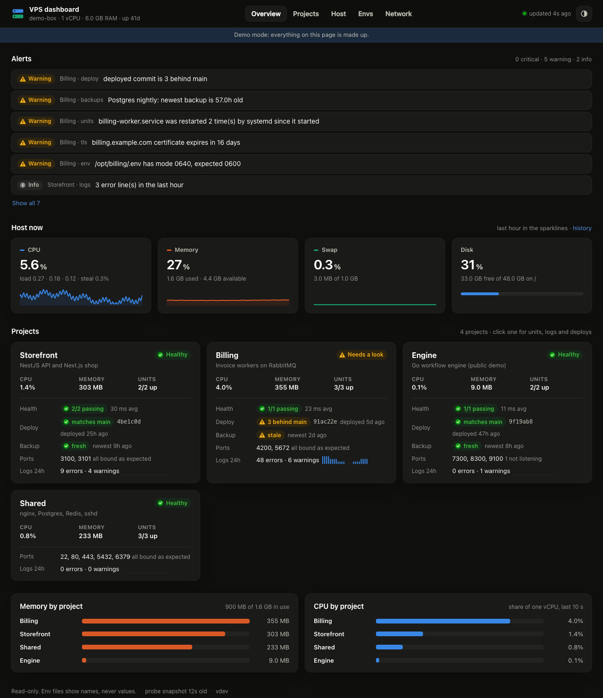

# vps-dashboard

A read-only dashboard for a small server that runs several side projects at once,
organised **by project** instead of by metric. One Go binary, no dependencies,
and it listens on `127.0.0.1` only: you look at it through an SSH tunnel. On a
1-vCPU ARM box running six projects, each of its two processes uses about 15 MB
of memory, and together they use about 0.3% of the CPU.



For each project it shows, on one page:

- **Units**: every systemd unit, its state, restarts, memory against its limit, CPU.
- **Ports**: the reserved-ports map checked against what is really listening, and
  anything bound to a public address that shouldn't be.
- **Health**: the public URLs, their status codes and latency.
- **Deploys**: which commit is on the server, how far behind `main` it is, and
  when the files last changed (with a hint when a restart looks pending).
- **Backups**: how old the newest file in each backup folder is.
- **Logs**: error and warning lines from the journal for the last 24 hours,
  with secrets redacted.
- **Env files**: variable **names only**, whether each is set or empty, the file's
  owner, mode and last change, plus stray `.env` backups lying around.

And for the machine: CPU, memory, swap and disk now and over 1 h / 6 h / 24 h / 7 d,
TLS certificate expiry for every hostname, and nginx requests per site.

Off-the-shelf tools (Cockpit, Netdata, Beszel) are good at per-metric views of a
host. This exists because the question on a shared box is usually per project:
*is liftoff OK, what's deployed, when did its backup last run?*

## The security model: two halves

Reading env files, root-only backup folders and other apps' logs needs privilege.
Serving a web page needs a network socket. No single process gets both.

| | `vps-dashboard serve` | `vps-dashboard probe` |
|---|---|---|
| Runs as | `vpsdash`, no capabilities | `vpsdash-probe`, `CAP_DAC_READ_SEARCH` (read any file) |
| Network | 127.0.0.1 listener, outbound HTTPS for checks and GitHub | **none** (`PrivateNetwork=yes`) |
| Reads | `/proc`, `systemctl show`, sysstat, world-readable deploy files | env files, backup folders, the journal, nginx logs |
| Writes | nothing | one snapshot file, `/var/lib/vps-dashboard/probe.json` |

The probe parses each env file into `(name, set or empty)` and drops the value.
Values exist for one probe cycle in memory, inside an opaque scrubber that
replaces them with `[env:NAME]` in log lines; every print, log and JSON path of
that scrubber is overridden to show only a count. Log lines are then redacted
again by pattern (URL passwords, JWTs, bearer tokens, `sk_`/`ghp_`/`re_`/`lk_`
keys, `password=`-style pairs, long opaque strings). nginx logs are reduced to
hourly counts per site; paths are never stored, because query strings carry tokens.

`internal/e2e/nosecrets_test.go` proves it: it plants random canary values in
env files, a token file, an env backup, the journal, nginx query strings and a
health-check response, runs the real probe, snapshot, collector and HTTP server,
and fails if any canary shows up in the snapshot, any API response, any static
asset or any log line. Turning the scrubber off makes it fail.

One known limit: the API has no login of its own. The SSH tunnel is the
access control, so any local user on the server can `curl 127.0.0.1:8400` and
see what the page shows (names, ages, counts, redacted errors; never values).
If that matters on your box, serve it on a Unix socket readable by one group and
tunnel with `ssh -L 8400:/run/vps-dashboard.sock`.

The web half is also read-only by construction: every route is `GET`, other
methods get `405`, and requests whose `Host` header isn't `localhost`/loopback
get `421`, so a web page can't use DNS rebinding to read the API while your
tunnel is open. A strict Content-Security-Policy allows scripts from the page's
own origin only.

## Install

Build on your laptop and copy the binary; the server needs no Go toolchain.

```sh
make release                     # dist/vps-dashboard-linux-{arm64,amd64}
cp config.example.json my.json   # describe your projects
go run ./cmd/vps-dashboard check-config --config my.json
scp dist/vps-dashboard-linux-arm64 my.json deploy/*.service deploy/install.sh server:/tmp/
ssh server 'sudo sh /tmp/install.sh /tmp/vps-dashboard-linux-arm64 /tmp/my.json /tmp'
```

`install.sh` creates the `vpsdash` and `vpsdash-probe` system users, installs a
root-owned binary in `/opt/vps-dashboard`, the config in `/etc/vps-dashboard`
(`root:vpsdash`, 0640) and the two units, then starts them. Run it again to upgrade;
the previous binary is kept as `vps-dashboard.prev`.

Then, from your laptop:

```sh
ssh -N -L 8400:127.0.0.1:8400 server
open http://localhost:8400
```

## Configuration

See [`config.example.json`](config.example.json). Unknown keys are rejected, so a
typo can't silently switch a check off. Per project:

| Key | Meaning |
|---|---|
| `units` | systemd units (`.service` is added when there's no suffix; timers work too) |
| `ports` | reserved ports; `"public": true` for the ones meant for the internet |
| `checks` | URLs to `GET`; `expect` defaults to 200; redirects are not followed |
| `hosts` | hostnames whose certificates to check and whose nginx counts to group |
| `deploy` | how to find the deployed commit (below) |
| `static_sites` | folders nginx serves directly; shows when they last changed |
| `backups` | `dir` + `glob` + `max_age`; the newest match decides fresh or stale |
| `env_files` | env files (names only); `secret_file: true` for single-value token files, which are never opened |
| `env_copy_globs` | where old copies of env files might sit (`.example` files are skipped) |
| `log_ignore` | regexps for journal lines to drop, such as sshd's internet-scanner noise |

`deploy.method`:

- `go_binary`: reads the commit Go stamps into a binary built inside a checkout.
- `git_dir`: reads `HEAD` from a `.git` folder that was copied with the code. For a
  private repo (`"private": true`) it compares with the copied `origin/main` instead of GitHub.
- `tree`: for code deployed with `git archive` (no `.git`): hashes every tracked file
  on disk the way git does and finds the newest of the last 20 commits on `main` that
  matches. Each folder in `trees` is matched on its own, so an API and a web app deployed
  on different days are both reported correctly. `exclude` skips paths that don't
  belong to that folder's deploy: `"frontend/"` (a prefix) when the frontend ships
  elsewhere, `"*.tsbuildinfo"` (a file name) for build output that is committed.

GitHub is called without a token, with `If-None-Match` on repeats (a 304 costs
nothing against the 60 requests/hour limit) and permanent caching of trees and
comparisons.

## Develop

```sh
make demo      # made-up data on http://127.0.0.1:8400, works on macOS
make ci        # gofmt check, vet (incl. linux/arm64), tests with -race, release build
```

The frontend is three hand-written files in `web/static` (no build step), compiled
into the binary with `go:embed`. Charts are inline SVG. Colours come from a
colour-blind-validated palette, and status is always shown with an icon and a label.

## License

Apache-2.0
